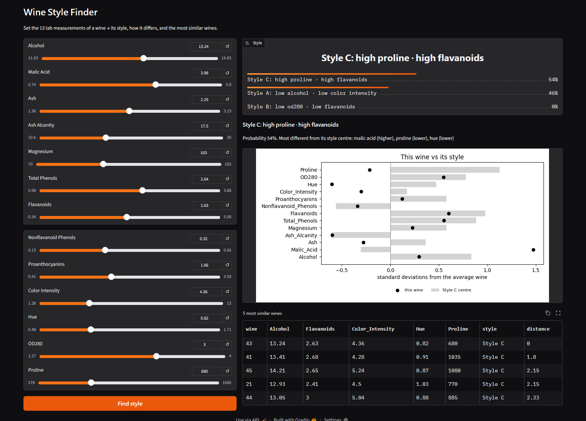
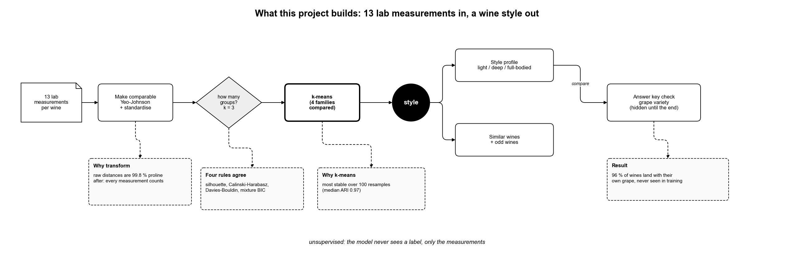
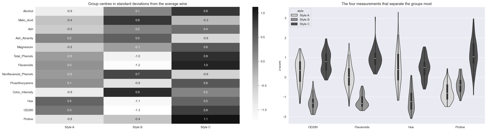
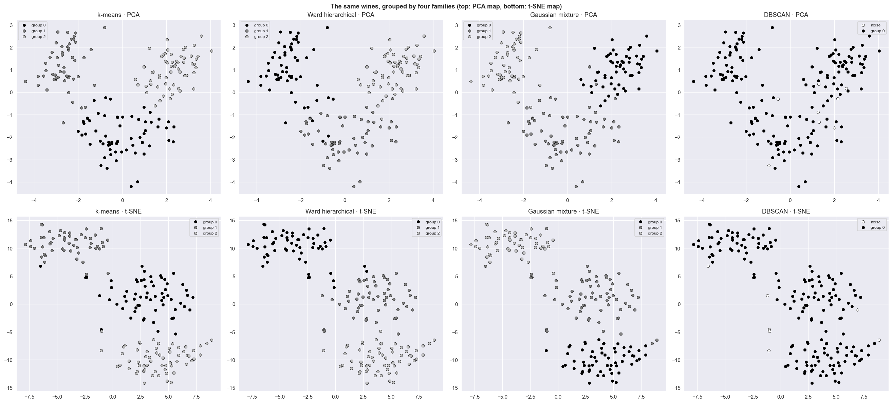
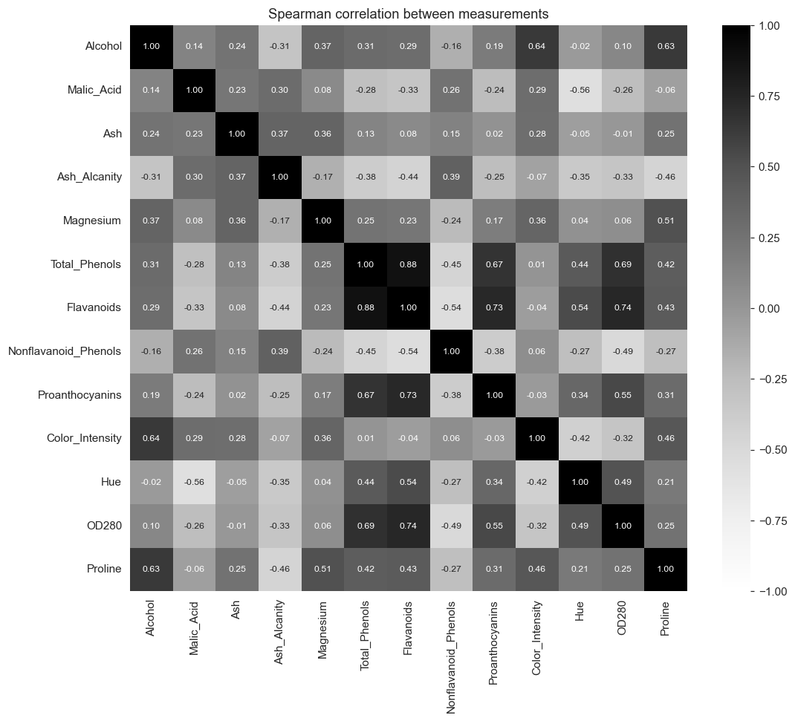
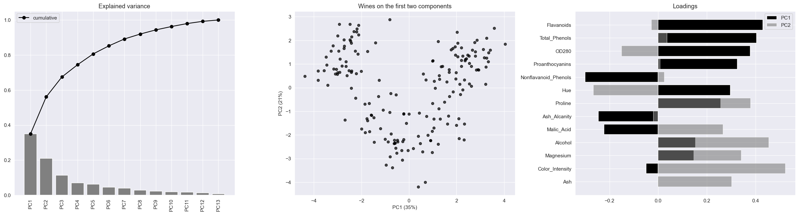
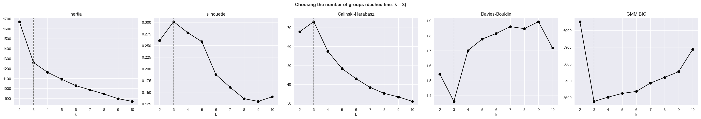
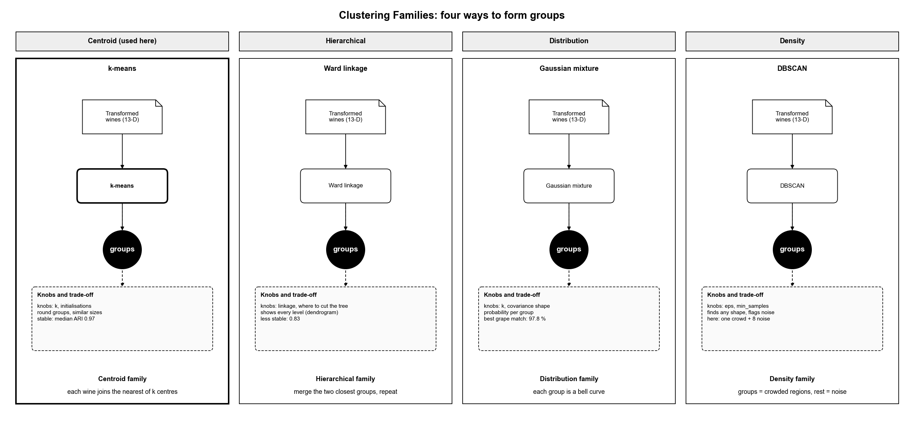
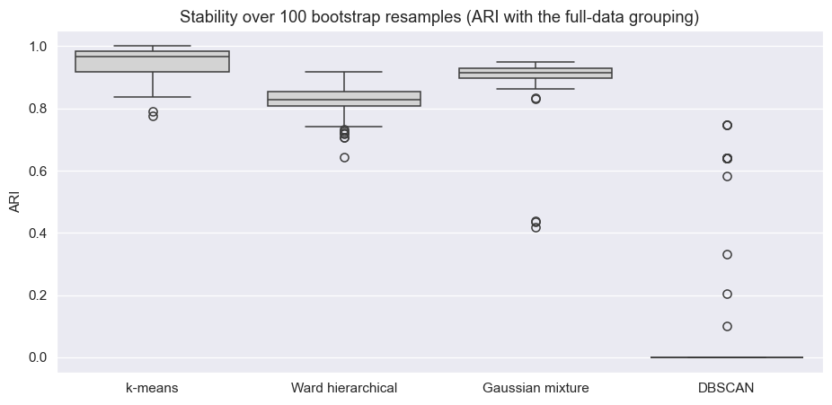

# Wine Clustering: Finding Wine Styles without Labels

Unsupervised learning | Clustering | k-means | Ward hierarchical | Gaussian mixture | DBSCAN | Yeo-Johnson | PCA | t-SNE | Silhouette | Bootstrap stability | Adjusted Rand index | Gradio

## Objective

- **Problem** → a shop or distributor has lab sheets for its wines but no agreed "style" labels, so shelves, menus and "if you liked this" suggestions are guesswork
- **Why this repo** → group the wines from their chemistry alone, check that the groups are stable, describe each group in plain words, and only then compare with the real grape varieties
- **Real-world use** → shelf and menu categories, "similar wines" suggestions, and a flag for wines that fit no style (a lab re-check or a special shelf)

## Highlights

**Question:** how many styles are hiding in 178 wines, and what are they?

**Answer:** three, and each can be described in one line. Four selection rules (silhouette, Calinski-Harabasz, Davies-Bouldin, mixture BIC) all pick k = 3.

| Style (k-means) | Wines | In plain words | Key numbers |
|---|---|---|---|
| A | 64 | light | 12.3 % alcohol, pale colour 3.0, proline 505 |
| B | 52 | deep, low in phenols | colour 7.2, brownish hue 0.70, flavanoids 0.82 |
| C | 62 | full-bodied | 13.7 % alcohol, flavanoids 3.0, proline 1,100 |

**Question:** are these real groups or an artefact of the method?

**Answer:** real for the model-based families, and the answer key agrees. k-means returns almost the same grouping on 100 bootstrap resamples (median ARI 0.97), and without ever seeing a label it puts 96.1 % of wines with their own grape variety; the Gaussian mixture reaches 97.8 %.

| Family | Silhouette | Stability (median ARI) | Wines with their own grape |
|---|---|---|---|
| k-means | 0.301 | 0.97 | 96.1 % |
| Gaussian mixture | 0.297 | 0.91 | **97.8 %** |
| Ward hierarchical | 0.290 | 0.83 | 92.1 % |
| DBSCAN | one crowd + 8 noise | 0.00 | 37.6 % |

**Question:** what is the most common mistake when clustering this kind of data?

**Answer:** forgetting to put the measurements on one scale. Proline is measured in hundreds of mg/L and holds 99.8 % of the raw variance, so k-means on the raw numbers is exactly "k-means on proline" (ARI 1.00). After a Yeo-Johnson transform every measurement has a say.

## [1/7] Data

- **Dataset** → [Wine Dataset for Clustering](https://www.kaggle.com/datasets/harrywang/wine-dataset-for-clustering) · 178 wines × 13 lab measurements, no missing values (not stored in this repository)
- **Answer key** → the same 178 wines, in the same order, ship with scikit-learn (`load_wine`) together with their grape variety (59 / 71 / 48); used only in the final check
- **Health** → mild skew (magnesium 1.09, malic acid 1.03); 21 IQR outliers are real wines and are kept
- **Redundancy** → total phenols, flavanoids, OD280 and proanthocyanins move together (Spearman 0.67-0.88)

## [2/7] Run on Kaggle

- **Import** → Create → Import Notebook → upload `wine_clustering.ipynb`
- **Input** → dataset `harrywang/wine-dataset-for-clustering` (default path `/kaggle/input/datasets/harrywang/wine-dataset-for-clustering`, searched under `/kaggle/input` if it moves)
- **Accelerator** → none (CPU, under a minute)
- **Settings** → top cell; `SAVE_FIGURES = False`, `LAUNCH_APP = False` → nothing is written, no app is started

## [3/7] Scaling and PCA

- **Yeo-Johnson** → each measurement made close to normal, then mean 0 and std 1; mean |skewness| 0.43 → 0.04
- **PCA** → two components keep 56 % of the variance (phenols on PC1, colour / alcohol / proline on PC2); five keep 80 %

## [4/7] How many groups and which family

- **k = 2 … 10** → every rule peaks at k = 3

- **Four families** → centroid, hierarchical, distribution, density; one model each

- **Stability** → fit on 100 bootstrap resamples, compare with the full-data grouping

## [5/7] Using the groups

- **New wine** → transform, then the Gaussian mixture gives P(style)
- **Similar wines** → the 5 nearest wines in the transformed space
- **Odd wines** → the lowest likelihood under the mixture; the oddest include the maximum flavanoids (5.08) and the maximum colour intensity (13.0)

## [6/7] App

- **Run locally** → `pip install -r requirements.txt` → `python app.py`
- **Data** → none needed: the model is rebuilt at start-up from scikit-learn's copy of the wines (about 2 seconds)
- **Output** → style probabilities, how the wine differs from its style centre, the 5 most similar wines, a warning for unusual wines

## [7/7] Next steps

- **Prices and taste-panel scores** → turn styles into shelves with price bands and tasting notes
- **More wines** → the larger UCI wine-quality data (6,497 red and white wines) to test whether the styles generalise
- **Feature selection** → one measurement per correlated family, to see if 6-7 measurements suffice

| Path | Content |
|---|---|
| `wine_clustering.ipynb` | full notebook (Kaggle-ready) |
| `app.py`, `requirements.txt` | Gradio style finder |
| `assets/png/` · `assets/drawio/` | figures (PNG) · editable draw.io diagrams |
| `arch/` | first version (a university group project with Box-Cox / Yeo-Johnson k-means) and a text-clustering variant on 130k Wine Enthusiast reviews |
