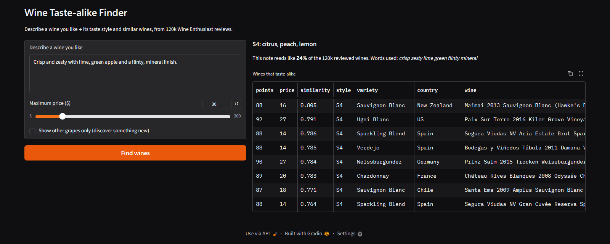
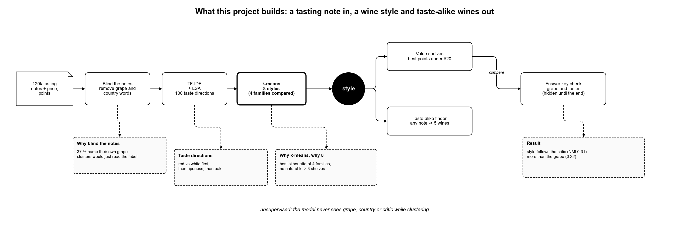
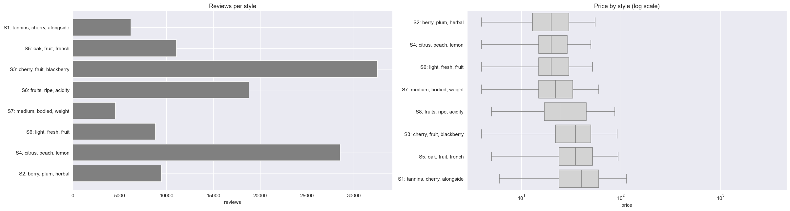
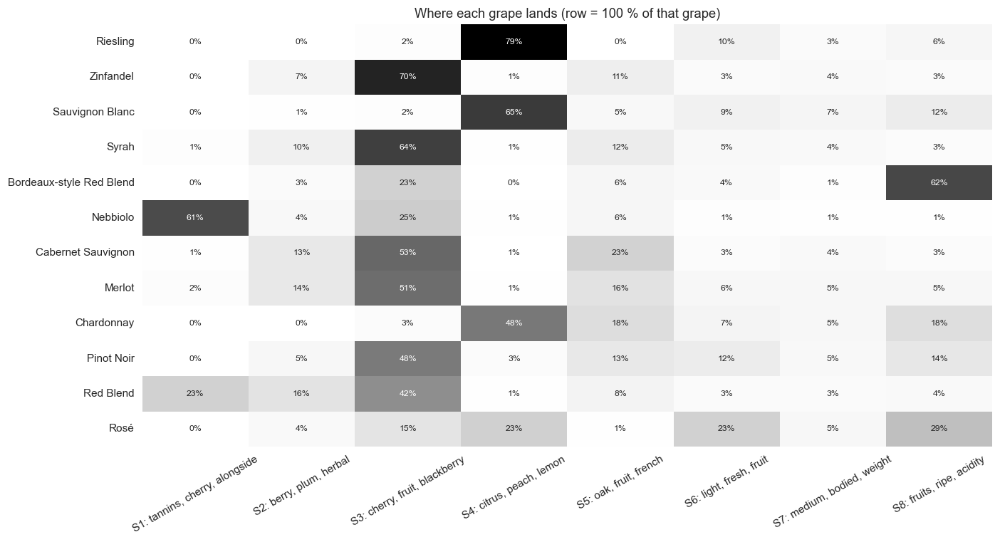
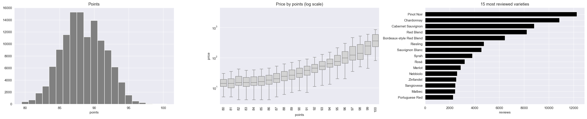
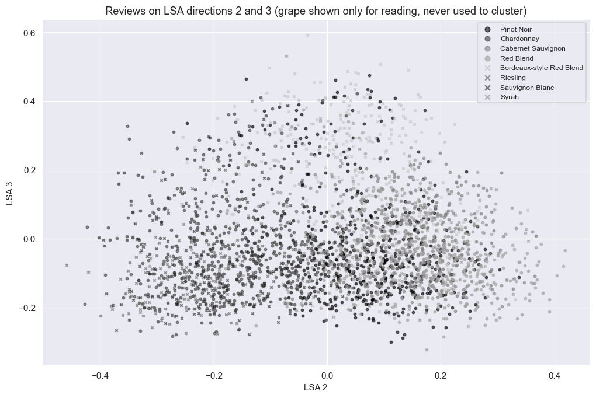
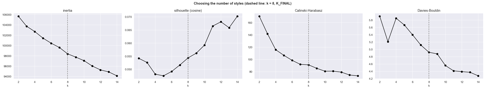

# Wine Clustering: Finding Wine Styles in 130k Tasting Notes

Unsupervised learning | Text clustering | TF-IDF | LSA (truncated SVD) | k-means | Ward hierarchical | Gaussian mixture | DBSCAN | Silhouette | Bootstrap stability | NMI / ARI | Recommendation | Gradio

## Objective

- **Problem** → shops and apps sort wine by grape and country, but people buy by taste ("crisp and citrusy", "big and oaky"), and a list of 700 grape names does not help them choose
- **Why this repo** → group 120k tasting notes into taste styles from the words alone (grape and country names removed), check how stable and how "grape-driven" the styles are, and find good value inside each style
- **Real-world use** → taste-based shelves and menus, "tastes like" suggestions across grapes and countries, and a value pick under $20 for every style

## Highlights

**Question:** what taste styles hide in 120k tasting notes?

**Answer:** eight usable shelves. The biggest are dark-fruit reds and citrus whites; oaky wines, light-and-fresh wines and medium-bodied wines follow. There is no "natural" number of styles (silhouette 0.05-0.07 for every k), so 8 is a shelf-count choice.

| Style (strongest words) | Wines | Median price | Typical grape |
|---|---|---|---|
| cherry, fruit, blackberry (dark-fruit reds) | 32,504 | $35 | Pinot Noir, Cabernet, Syrah, Zinfandel |
| citrus, peach, lemon (crisp whites) | 28,542 | $20 | Chardonnay, Riesling, Sauvignon Blanc |
| oak, fruit, french (oaky) | 11,066 | $35 | Cabernet Sauvignon, Chardonnay |
| light, fresh, fruit | 8,826 | $20 | Pinot Noir, Rosé |
| medium, bodied, weight | 4,562 | $22 | Pinot Noir |

**Question:** are the styles just the grapes again?

**Answer:** no, and the surprise is who wrote the note. Style follows the critic (NMI 0.31) more than the grape (NMI 0.22). Three of the eight styles are mostly one writer's vocabulary: "fruits, ripe, acidity" is 94 % Roger Voss, "tannins, cherry, alongside" 96 % Kerin O'Keefe, "berry, plum, herbal" 79 % Michael Schachner. Grapes still matter: 79 % of Rieslings land in the citrus whites, while Pinot Noir and Rosé spread over several styles.

**Question:** what does a better score cost, and is there value in every style?

**Answer:** each extra point costs about 14 % more (median $16 at 85 points, $30 at 90, $75 at 95), yet 35.6 % of wines cost $20 or less and every style has 92-96-point bottles at that price.

| Style | Example under $20 | Points | Price |
|---|---|---|---|
| dark-fruit reds | Rulo 2007 Syrah (Columbia Valley) | 96 | $20 |
| crisp whites | Dunham 2010 Lewis Estate Riesling (Columbia Valley) | 95 | $20 |
| oaky | Joseph Carr 2009 Dijon Clone Chardonnay (Sonoma) | 94 | $18 |

## [1/7] Data

- **Dataset** → [Wine Reviews](https://www.kaggle.com/datasets/zynicide/wine-reviews) (Wine Enthusiast) · `winemag-data-130k-v2.csv` · 129,971 reviews (not stored in this repository)
- **Cleaning** → 9,983 repeated reviews removed → 119,987 wines; price missing for 7 %, critic for 21 %
- **Selection** → only wines scored 80-100 are published (median 88), so "bad" wines are absent

## [2/7] Run on Kaggle

- **Import** → Create → Import Notebook → upload `wine_clustering.ipynb`
- **Input** → dataset `zynicide/wine-reviews` (default path `/kaggle/input/datasets/zynicide/wine-reviews`, searched under `/kaggle/input` if it moves)
- **Accelerator** → none (CPU, about 5 minutes)
- **Settings** → top cell; `SAVE_FIGURES = False`, `LAUNCH_APP = False` → nothing is written, no app is started

## [3/7] Blind the notes, then turn words into numbers

- **Blind** → 37 % of notes name their own grape; 1,006 grape, country and region words are removed so styles come from taste words (median 18 per note)
- **TF-IDF + LSA** → 20,000 words and phrases → 100 taste directions; the first splits red (cherry, tannins, blackberry) from white (crisp, citrus); the next ones are ripeness and oak

## [4/7] How many styles and which family

- **k-means wins** → silhouette 0.059 vs Gaussian mixture 0.043, Ward 0.019; DBSCAN finds 2 groups and 9 % noise (notes have no empty gaps)
- **Stability** → median ARI 0.41 over 30 resamples: the big styles return every time, borders between small ones move

## [5/7] Taste-alike finder

- "Crisp and zesty with lime, green apple and a flinty, mineral finish" → citrus whites; nearest wines: a German Riesling, a $16 New Zealand Sauvignon Blanc, a $14 Spanish Verdejo, a $14 Cava
- the finder works across grapes and countries, with a price cap and an "other grapes only" switch

## [6/7] App

- **Run locally** → `pip install -r requirements.txt` → put `winemag-data-130k-v2.csv` in `./data` (or set `WINE_REVIEWS_CSV`) → `python app.py`
- **First start** → builds the index in about 35 seconds and caches it in `./cache` (git-ignored)

## [7/7] Next steps

- **Normalise each critic** → remove writer habits (per-critic TF-IDF or a critic-adversarial embedding) so styles are about the wine, not the writer
- **Sentence embeddings** → compare LSA with a modern text encoder for the taste-alike search
- **Price-aware recommendations** → "like this, but cheaper" ranked by similarity per dollar

| Path | Content |
|---|---|
| `wine_clustering.ipynb` | full notebook (Kaggle-ready) |
| `app.py`, `requirements.txt` | Gradio taste-alike finder |
| `assets/` | figures and editable draw.io diagrams |
| `arch/` | earlier versions: lab-chemistry clustering of 178 wines (`wine_clustering_chemistry.ipynb`) and the first group project |
